 

### QA Automation Engineer · Test Engineering · AI-Assisted Development

Building reliable software through thoughtful testing, practical automation, and intelligent engineering.

---

## `>_` About

I'm **Satyendra Kumar Namdeo**, a QA-focused engineer interested in building dependable products through test design, browser and mobile automation, API validation, and AI-assisted engineering.

I enjoy turning complex workflows into repeatable tests, investigating failures with evidence, and building tools that make engineering teams more effective.

- **Quality engineering:** functional, regression, integration, API, and end-to-end testing
- **Automation:** Playwright, Selenium, Appium, Pytest, and Page Object Model
- **Engineering:** Python, JavaScript, TypeScript, Flask, FastAPI, and SQL
- **AI projects:** practical AI-assisted search, testing, and productivity workflows
- **Ways of working:** reproducible bugs, clear documentation, maintainable automation, and evidence-led debugging

## ⚡ Current engineering focus

- Designing maintainable browser automation and reusable test architecture.
- Improving test reliability through robust locators, fixtures, assertions, and trace-based debugging.
- Exploring AI-assisted test discovery, test generation, and quality workflows.
- Building developer tools that solve practical engineering problems.

## 🧩 Featured work

A selection of public repositories. Project status and implementation details are documented in each repository.

| Project | What it explores | Stack |
|---|---|---|
| [**AI78QA**](https://github.com/SanFlash/AI78QA) | AI-assisted QA platform for application discovery, traceable test design, automation, and evidence | Next.js, TypeScript, FastAPI, Playwright |
| [**Record2POM**](https://github.com/SanFlash/record2pom) | Browser recording and Page Object Model automation studio | JavaScript, Playwright, Python |
| [**SatyTracker78**](https://github.com/SanFlash/satyenstg1) | Local-first browser workflow toolkit with an optional Windows companion | React, TypeScript, Chrome APIs, .NET |
| [**SATYON-AI**](https://github.com/SanFlash/SATYON-AI) | Multi-source AI search and research aggregation | Python, FastAPI, JavaScript |
| [**SatyOne**](https://github.com/SanFlash/SatyOne) | Local-first AI command and prompt-workflow workspace | React, TypeScript, FastAPI, SQLite |
| [**Automation Exercise**](https://github.com/SanFlash/automationExercise) | Playwright automation framework and practical engineering guide | JavaScript, Playwright, Cucumber, GitHub Actions |
| [**Portfolio**](https://github.com/SanFlash/SanFlash-SatyendraNamdeoPortfolio) | Personal portfolio and interactive project showcase | HTML, CSS, JavaScript |

## 🛠️ Technology toolbox

## 📊 GitHub activity

## 🐍 Contribution trail

## 🤝 Connect

I'm interested in meaningful conversations around QA engineering, automation architecture, developer tooling, and practical AI applications.

- **Portfolio:** https://sanflash.github.io/SanFlash-SatyendraNamdeoPortfolio/
- **LinkedIn:** https://www.linkedin.com/in/satyendra-namdeo/
- **GitHub:** https://github.com/SanFlash

Designed with a midnight-indigo visual identity · Built with curiosity, quality, and continuous improvement.

